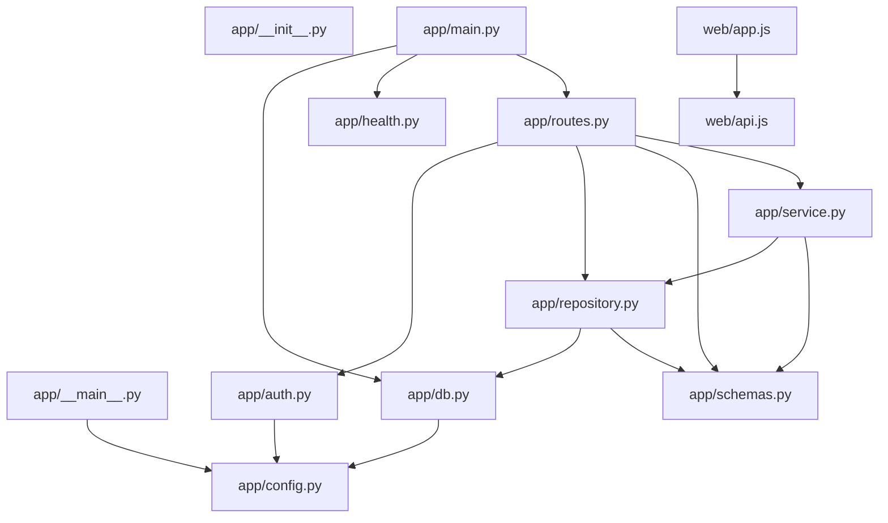

# TicketDesk architecture overview

Snapshot: `53353f52eefe1fdb81e4803d099000267fb3100f`

## Tech stack

- Python, FastAPI and Uvicorn (requirements.txt)
- SQLite persistence (app/db.py imports sqlite3)
- HTML/CSS with browser JavaScript modules (web/index.html)

## Key entry points

- python -m app starts Uvicorn (app/__main__.py).
- FastAPI application registration: `app/main.py:20–20`.
- Database startup: `app/main.py:13–17`.
- POST /api/tickets: `app/routes.py:14–20`.
- GET /api/tickets: `app/routes.py:23–26`.
- GET /health: `app/health.py:7–10`.
- Browser ticket submission: `web/app.js:22–32`.

## Local module dependencies

Arrows point from the importer to the imported module. This is a static graph.

### Import edges

- `app/__main__.py` → `app/config.py`
- `app/auth.py` → `app/config.py`
- `app/db.py` → `app/config.py`
- `app/main.py` → `app/db.py`, `app/health.py`, `app/routes.py`
- `app/repository.py` → `app/db.py`, `app/schemas.py`
- `app/routes.py` → `app/auth.py`, `app/repository.py`, `app/schemas.py`, `app/service.py`
- `app/service.py` → `app/repository.py`, `app/schemas.py`
- `web/app.js` → `web/api.js`

## Coverage

- 13 indexed modules; 15 local import edges.
- Cycles: none detected.
- Dynamic imports and runtime dependencies are outside this static view.
